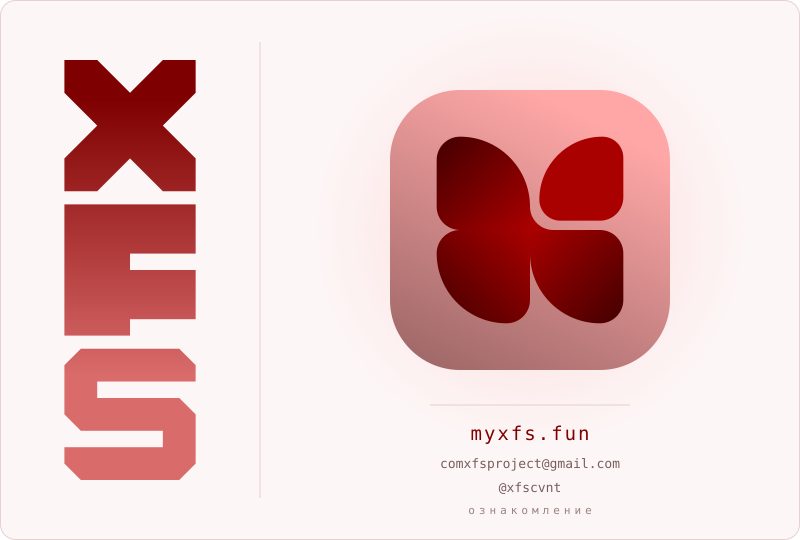

<!--
  XFS — profile card: vertical XFS wordmark + the mark + contacts.

  Deliberately no absolute links inside, so renaming the account or the repo
  does not break anything. Regenerate: python build_profile.py
-->

<picture>
  <source media="(prefers-color-scheme: dark)" srcset="xfs-card-dark.svg">
  
</picture>
